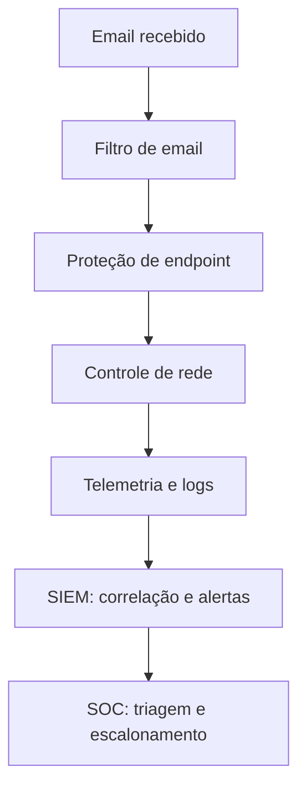

# Build Your Cyber Security Career

> Relatório de estudos — TryHackMe | Cyber Security 101 | Formação em segurança defensiva (Blue Team)

**Data de conclusão informada:** 25/11/2026  
**Objetivo profissional:** SOC Analyst L1 / Analista de Segurança da Informação Júnior  
**Natureza das atividades:** estudos teóricos, exercícios interativos e avaliação orientativa de carreira.

## Sumário

- [1. Objetivos](#1-objetivos)
- [2. Training Impact on Teams](#2-training-impact-on-teams)
- [3. Security Principles](#3-security-principles)
- [4. Careers in Cyber](#4-careers-in-cyber)
- [5. Aplicação ao SOC Level 1](#5-aplicação-ao-soc-level-1)
- [6. Limitações e lições aprendidas](#6-limitações-e-lições-aprendidas)
- [7. Próximos passos](#7-próximos-passos)
- [8. Referências](#8-referências)

## 1. Objetivos

Consolidar os fundamentos de segurança da informação, compreender o impacto da capacitação técnica nas organizações e identificar caminhos profissionais compatíveis com a atuação em segurança defensiva.

| Sala | Conhecimento desenvolvido |
|---|---|
| Training Impact on Teams | Capacitação corporativa, produtividade e retorno sobre investimento |
| Security Principles | Tríades CIA e DAD, modelos de segurança, defesa em profundidade e princípios de projeto |
| Careers in Cyber | Funções profissionais, competências e direcionamento de carreira |

## 2. Training Impact on Teams

### 2.1 Capacitação e impacto organizacional

O treinamento contínuo permite preparar equipes antes da ocorrência de incidentes, desenvolver profissionais juniores, estabelecer uma base comum de competências e reduzir a dependência de profissionais mais experientes para tarefas repetitivas de capacitação.

Laboratórios controlados permitem praticar procedimentos sem comprometer sistemas de produção. A capacitação também favorece a colaboração e a avaliação estruturada de habilidades.

### 2.2 Treinamento corporativo personalizado

| Conceito | Descrição |
|---|---|
| Content Studio | Recurso apresentado pelo TryHackMe para criação e personalização de trilhas de treinamento corporativas. |
| SSO (Single Sign-On) | Autenticação integrada que permite acessar aplicações com uma sessão de identidade compartilhada. |
| API (Application Programming Interface) | Interface que possibilita a integração entre aplicações e serviços. |

### 2.3 Exercício de impacto financeiro

O exercício apresentou uma equipe de 20 funcionários, custo anual individual de US$ 50.000, aumento estimado de produtividade de 4% e treinamento de US$ 500 por funcionário.

```text
Ganho estimado = 20 × 50.000 × 0,04 = US$ 40.000
Investimento = 20 × 500 = US$ 10.000
Retorno bruto / investimento = 40.000 / 10.000 × 100 = 400%
ROI líquido = (40.000 − 10.000) / 10.000 × 100 = 300%
```

A sala utiliza a razão entre ganho bruto e investimento (400%). A fórmula convencional de ROI líquido, descontando o custo, resulta em 300%. A distinção evita interpretações equivocadas em propostas corporativas. O ganho de produtividade é uma estimativa hipotética, não uma economia financeira comprovada.

## 3. Security Principles

### 3.1 Terminologia fundamental

| Termo | Definição |
|---|---|
| Asset (Ativo) | Recurso de valor que necessita de proteção. |
| Vulnerability (Vulnerabilidade) | Fraqueza que pode ser explorada. |
| Threat (Ameaça) | Circunstância ou agente com potencial de causar dano. |
| Risk (Risco) | Consideração da probabilidade e do impacto de um evento adverso. |
| Security Control (Controle de segurança) | Medida destinada a reduzir riscos. |

Não existe segurança absoluta. Os controles devem ser selecionados considerando os ativos, as ameaças e os riscos do ambiente.

### 3.2 Tríades CIA e DAD

| CIA — objetivo de proteção | DAD — violação correspondente | Exemplo |
|---|---|---|
| Confidentiality (Confidencialidade) | Disclosure (Divulgação) | Vazamento de registros de clientes. |
| Integrity (Integridade) | Alteration (Alteração) | Modificação indevida de dados financeiros. |
| Availability (Disponibilidade) | Destruction/Denial (Destruição/Negação) | Interrupção da infraestrutura de rede. |

Durante os exercícios interativos, foram analisados cenários envolvendo documentos falsificados, verificação de assinaturas, sigilo de informações e disponibilidade contínua de serviços. A verificação de assinaturas está diretamente relacionada à autenticidade; quando limitada às três alternativas CIA, a atividade a enquadrou como integridade.

### 3.3 Além da CIA

- **Authenticity (Autenticidade):** verificar se a origem declarada de uma informação é genuína.
- **Nonrepudiation (Não repúdio):** estabelecer evidências que dificultem a negação de autoria ou de uma ação realizada.
- **Parkerian Hexad:** modelo de seis propriedades — confidencialidade, integridade, disponibilidade, autenticidade, posse e utilidade. Não repúdio é um conceito complementar, não um dos seis elementos desse modelo.

A perda da posse de um dispositivo criptografado não implica automaticamente perda da confidencialidade. Dados criptografados cuja chave foi perdida podem continuar existentes, mas perder sua utilidade.

### 3.4 Modelos de segurança

| Modelo | Objetivo | Regras fundamentais |
|---|---|---|
| Bell-LaPadula | Confidencialidade | No read up; no write down. |
| Biba (modelo estrito) | Integridade | No read down; no write up. |
| Clark-Wilson | Integridade | Alterações controladas por procedimentos autorizados e verificações de integridade. |

No Bell-LaPadula, informações de classificação superior não podem ser lidas por sujeitos de nível inferior; a escrita para níveis inferiores é restringida. No Biba estrito, a leitura de fontes de menor integridade e a escrita em níveis superiores são restringidas. O Clark-Wilson enfatiza transações bem formadas e controles sobre a modificação de dados.

| Sigla Clark-Wilson | Significado |
|---|---|
| CDI | Constrained Data Item — dados protegidos. |
| UDI | Unconstrained Data Item — dados não submetidos aos controles de integridade do modelo. |
| TP | Transformation Procedure — procedimento autorizado de transformação. |
| IVP | Integrity Verification Procedure — procedimento de verificação de integridade. |

### 3.5 Defence-in-Depth

A defesa em profundidade combina controles complementares para que a falha de uma camada não resulte necessariamente no comprometimento completo do ativo.

Exemplo ilustrativo de aplicação corporativa:



O fluxo é conceitual, não representa uma infraestrutura implantada neste laboratório. Backups, segmentação, autenticação multifator e controle de acesso também podem compor uma estratégia de defesa em profundidade.

### 3.6 ISO/IEC 19249

A sala apresentou os seguintes princípios de arquitetura e projeto de segurança.

**Princípios arquiteturais**

| Nº | Princípio | Aplicação |
|---|---|---|
| 1 | Domain Separation | Separar domínios com requisitos de segurança distintos. |
| 2 | Layering | Organizar funções e controles em camadas. |
| 3 | Encapsulation | Restringir acesso direto a dados e estados internos. |
| 4 | Redundancy | Reduzir dependência de componentes únicos. |
| 5 | Virtualization | Isolar e abstrair recursos por virtualização. |

**Princípios de projeto**

| Nº | Princípio | Aplicação |
|---|---|---|
| 1 | Least Privilege | Conceder apenas permissões necessárias. |
| 2 | Attack Surface Minimisation | Reduzir serviços e pontos de exposição desnecessários. |
| 3 | Centralised Parameter Validation | Centralizar validação de entradas. |
| 4 | Centralised General Security Services | Centralizar serviços comuns de segurança. |
| 5 | Preparing for Error and Exception Handling | Preparar tratamento seguro de erros e exceções. |

Os exercícios abordaram a desativação de um servidor inseguro não essencial (princípio 2), a concessão de acesso restrito a um representante comercial (princípio 1) e o tratamento de falhas de rede e energia em um caixa eletrônico (princípio 5).

Zero Trust e Trust but Verify também foram mencionados nos objetivos da sala. Não há registros detalhados das respectivas atividades nesta sessão de acompanhamento; por isso, não são apresentados como exercícios validados individualmente.

## 4. Careers in Cyber

A sala apresentou diferentes possibilidades de atuação em segurança cibernética e discutiu capacitação, certificações, remuneração e proteção de infraestruturas críticas.

| Função | Foco principal |
|---|---|
| Security Analyst | Avaliação e melhoria dos controles de segurança. |
| SOC Analyst | Monitoramento, triagem e investigação de alertas. |
| Incident Responder | Contenção, resposta e recuperação de incidentes. |
| Penetration Tester | Testes de segurança autorizados. |
| Red Teamer | Simulação autorizada de adversários. |
| Security Engineer | Projeto e implementação de soluções de segurança. |

### 4.1 Avaliação orientativa de perfil

O questionário interativo retornou o perfil **Security Analyst**, recomendando as trilhas Pre Security, SOC Level 1 e Jr Penetration Tester.

As escolhas foram orientadas para atividades investigativas, análise de logs, validação de alertas e identificação antecipada de problemas. Portanto, o resultado é coerente com o direcionamento de carreira adotado, mas não constitui avaliação vocacional independente, certificação técnica ou comprovação de experiência profissional.

As afirmações da sala sobre crescimento do mercado e remuneração foram estudadas como conteúdo didático, sem validação independente de dados atuais do mercado brasileiro.

## 5. Aplicação ao SOC Level 1

| Conhecimento | Aplicação esperada em um SOC |
|---|---|
| CIA e DAD | Classificar impactos de incidentes. |
| Ativo, ameaça, vulnerabilidade e risco | Contextualizar alertas e apoiar priorização. |
| Menor privilégio | Identificar permissões excessivas. |
| Defesa em profundidade | Compreender a atuação complementar de controles. |
| Modelos de segurança | Interpretar restrições de acesso e requisitos de integridade. |
| Treinamento contínuo | Desenvolver procedimentos e competências operacionais. |

Essas competências complementam os estudos anteriores de ferramentas defensivas, mas não substituem a prática operacional com SIEM, EDR e resposta a incidentes.

## 6. Limitações e lições aprendidas

- Os exercícios desta seção foram predominantemente conceituais; não houve implantação de SIEM, EDR ou infraestrutura de segurança.
- Os desafios cronometrados exigiram novas tentativas. Uma tabela de revisão permitiu reduzir a dependência do envio de capturas durante a contagem regressiva.
- A conclusão da seção foi informada pelo estudante; não houve verificação independente de certificado ou de progresso na plataforma.
- O registro das atividades de Security Principles é parcial para os tópicos posteriores à ISO/IEC 19249.
- Nenhuma flag, senha ou credencial foi incluída neste documento.

## 7. Próximos passos

1. Prosseguir para a trilha SOC Level 1.
2. Aprofundar análise e correlação de logs, triagem de alertas e investigação de phishing.
3. Praticar monitoramento e investigação com SIEM e EDR em ambiente controlado.
4. Desenvolver procedimentos de resposta, documentação e escalonamento de incidentes.
5. Consolidar evidências técnicas no GitHub, distinguindo exercícios de experiências profissionais reais.

## 8. Referências

- TryHackMe — Cyber Security 101, seção Build Your Cyber Security Career: Training Impact on Teams, Security Principles e Careers in Cyber. Material didático e capturas utilizados durante as sessões de estudo.
- ISO/IEC 19249:2017 — *Information technology — Security techniques — Catalogue of architectural and design principles for secure products, systems and applications*. Referência apresentada na sala; o texto integral da norma não foi consultado.
- [TryHackMe](https://tryhackme.com/)

---

*Relatório educacional de portfólio. As atividades descritas foram realizadas ou discutidas em ambiente de treinamento autorizado.*
